# Nigrani

*Nigrani* (निगरानी) is Hindi for "watchful oversight".

A self-hosted monitoring and alerting dashboard you can drop into any Docker project.

Nigrani sits **on top of** Prometheus (and optionally Loki). It doesn't replace them. It gives you one place to see
what's healthy, what the thresholds are, what is about to break, and it sends you a message on Slack, Microsoft
Teams, Telegram, email, WhatsApp, Discord or any webhook when something does.

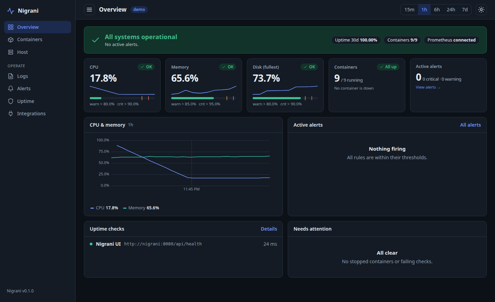

## Why

Grafana is great for exploring metrics but it won't tell you "the disk fills in 1.4 days" or page you when a container
silently stops. Nigrani answers the operational questions directly:

- **Is everything OK right now?** One status banner. Every tile shows its warn/critical thresholds on the bar.
- **What is about to break?** Disk-full forecast, crash-loop detection, scrape targets that went down.
- **Tell me when it does.** An alert engine with `pending → firing → resolved`, de-duplication, reminders, silences,
  quiet hours, and automatic retry if a channel is down.
- **Why?** Per-container CPU/memory/network, live logs (Loki), and deploy markers on the charts so you can see
  that the spike started right after a release.

## Features

| | |
|---|---|
| **Overview** | Status banner, key tiles with thresholds, CPU/memory trend, active alerts, uptime checks |
| **Containers** | Every container: status, CPU, memory (vs limit), restarts, uptime, network. Click for charts and logs. Auto-detects stopped containers |
| **Host** | CPU, memory, load, network, disk I/O, per-filesystem usage with **days-until-full forecast** |
| **Sentry** | Unresolved, new and fatal issues on their own page, alert rules over Sentry searches, and the matching issues on an incident's page |
| **AWS CloudWatch** | Alert rules straight on CloudWatch metrics (RDS, EC2, ELB, SQS, anything), one alert per database or instance, with the metric charted on the incident page. No exporter needed |
| **Kubernetes** | Nodes, pods and deployments on their own page, and alert rules for crash-looping or failed pods, stuck or restarting pods, unready nodes and deployments missing replicas. Read-only, no agent in the cluster |
| **Grafana links** | "Open in Grafana" from an alert, a rule or the Logs page (Explore with the same query and time range), plus links to your own dashboards from the incident, container, host and overview screens |
| **Service pages** | Traffic (Django), Redis, Postgres, AWS RDS, MQTT, Celery out of the box. Add your own pages in YAML |
| **Incident page** | Click any alert for everything around it: lifecycle timeline, the metric with thresholds, the container's CPU/memory and logs, deploys and restarts just before it started, and other alerts that fired at the same time ("What changed?") |
| **Alerts** | Rules editable in the UI (thresholds, duration, PromQL with live preview), silences, and an **incident timeline** showing when each alert started, how long it lasted and what its peak was |
| **Integrations** | Slack, Teams, Discord, Telegram, Email, WhatsApp (Twilio), signed webhook. Per-channel severity + quiet hours, "send test" button |
| **Uptime** | HTTP / TCP / TLS-certificate-expiry checks with 30-day uptime and an optional public status page |
| **Deploys** | GitHub Actions runs (pull-request and Dependabot runs are ignored), shown as dashed markers on charts |
| **Digest** | A daily or weekly summary message |
| **Users and roles** | Several people with viewer / editor / admin roles, password or single sign-on (Google, Microsoft, Okta, Keycloak... any OpenID Connect provider), and an audit log of sign-ins and changes |
| **Backup** | Export and restore rules, channels and silences as one JSON file, with a dry-run before anything changes |
| **Multiple servers** | Watch production and staging (or any number of environments) from one dashboard, with an all-servers view and per-server routing of alerts |
| **UI** | Light/dark, responsive, keyboard accessible, no external fonts or CDNs |

<p>
  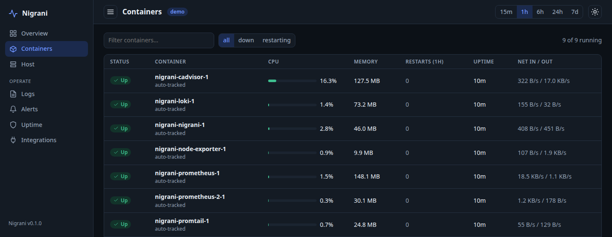
  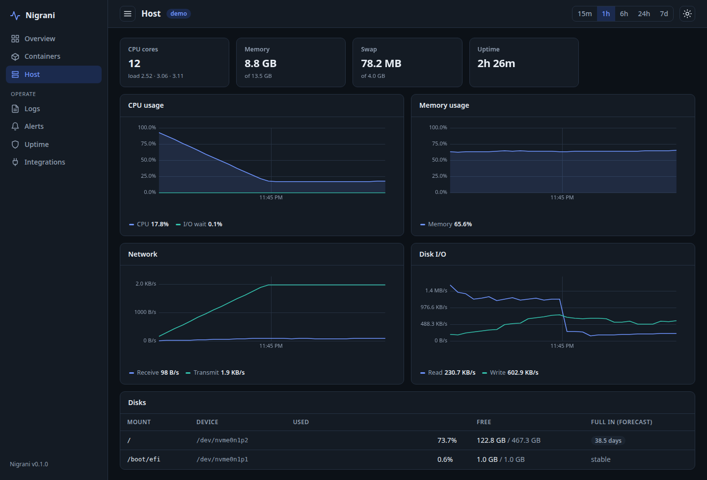
</p>
<p>
  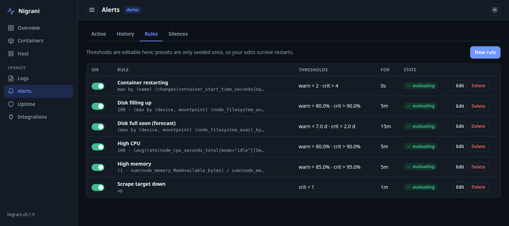
  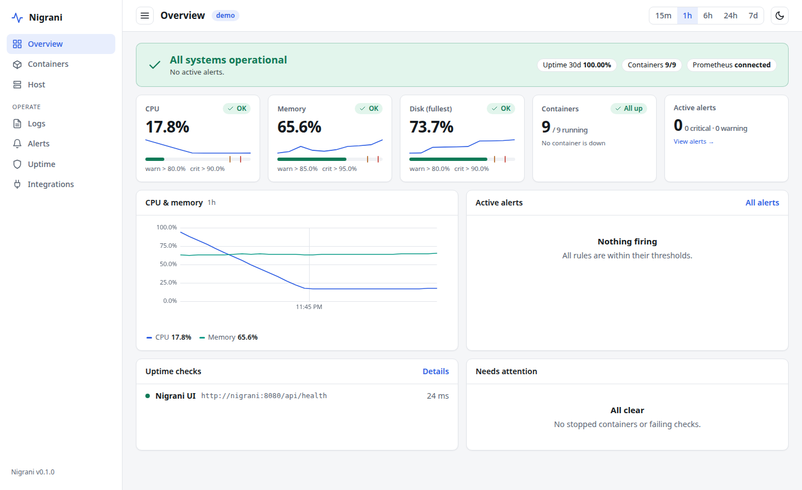
</p>
<p>
  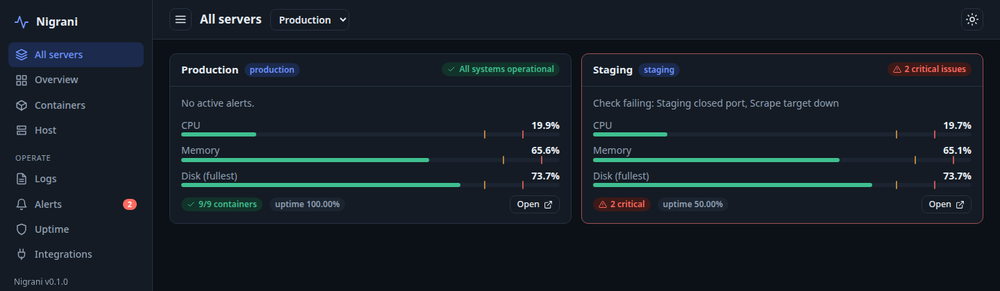
  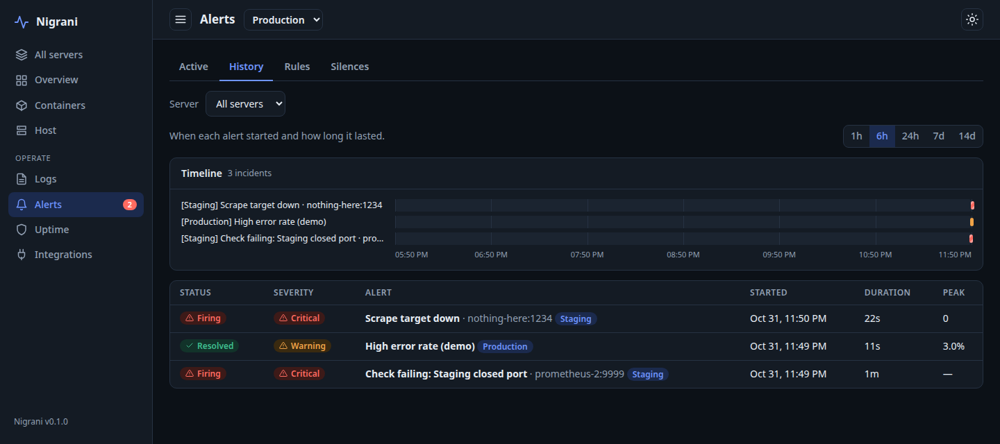
</p>
<p>
  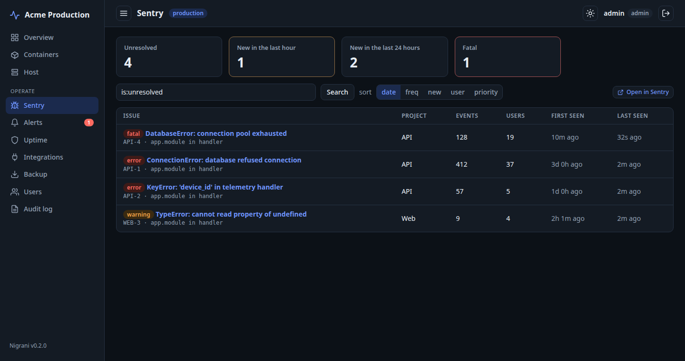
  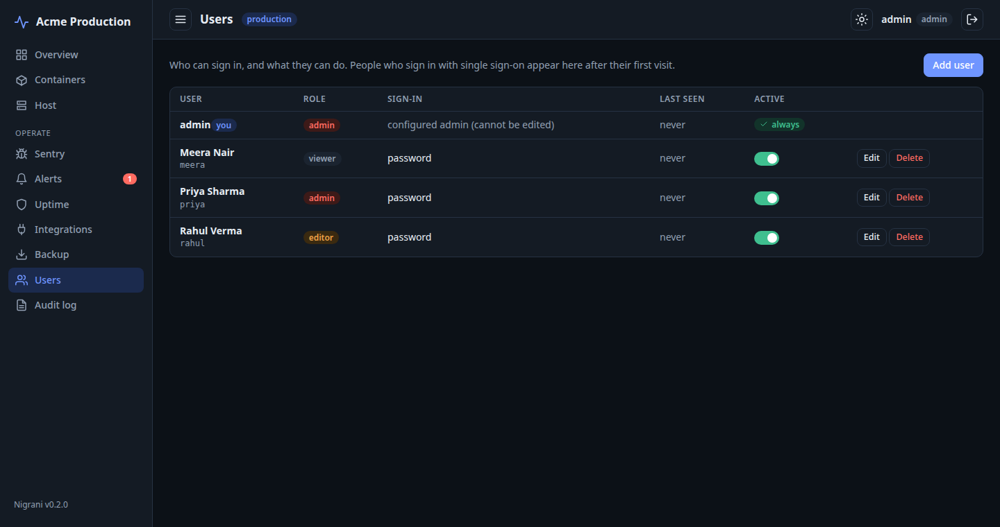
</p>
<p>
  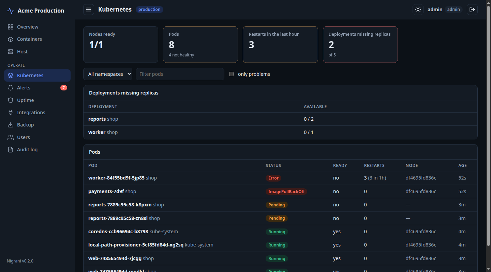
</p>
<p>
  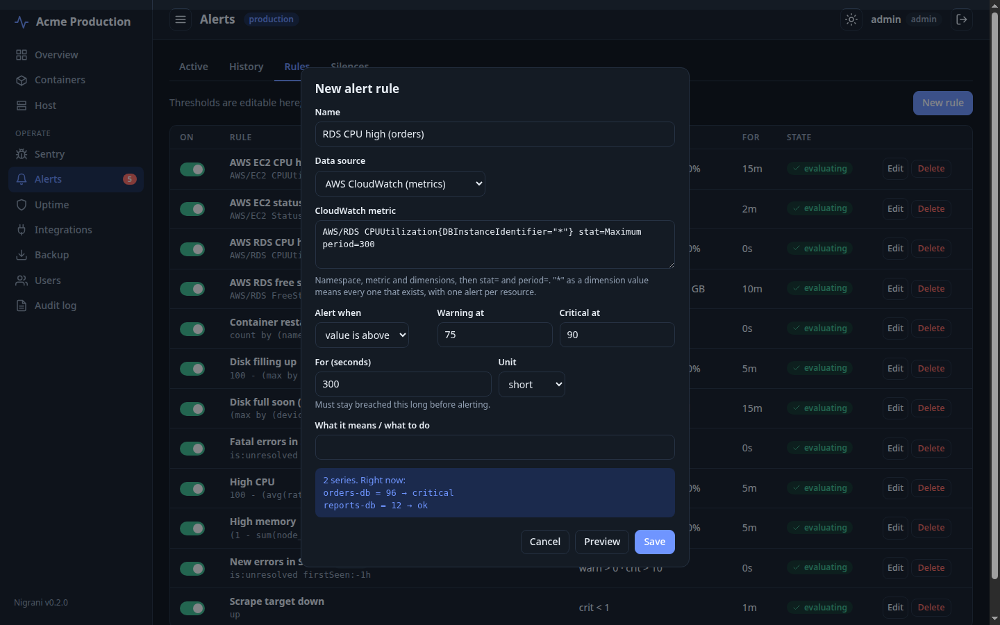
  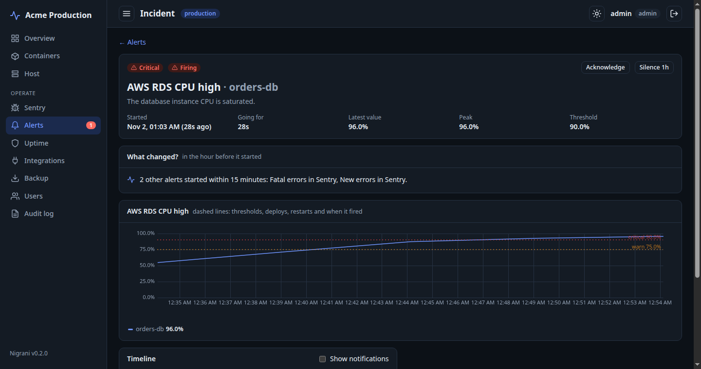
</p>

## Quick start

### A. Try it in two minutes (everything included)

Starts Prometheus, node-exporter, cAdvisor, Loki, Promtail and Nigrani, and monitors the machine it runs on.

```bash
git clone https://github.com/nikhilrai-tech/Nigrani.git && cd Nigrani
cp .env.example .env            # set NIGRANI_PASSWORD
docker compose -f docker-compose.full.yml up -d --build
# open http://localhost:8080  (user: admin)
```

Give it about a minute for Prometheus to collect its first samples.

### B. Add Nigrani to the stack you already have

1. Copy [nigrani.example.yaml](nigrani.example.yaml) to `nigrani.yaml`; point `datasources.prometheus` at your Prometheus
   and pick the `presets` that match the exporters you run.
2. Add the service from [examples/add-to-existing-compose.yml](examples/add-to-existing-compose.yml) to your
   `docker-compose.yml` (or run [docker-compose.yml](docker-compose.yml) from this repo, joining your network).
3. Set `NIGRANI_PASSWORD` in your `.env` and `docker compose up -d`.

### C. Plain `docker run`

Once a release is published you can use `ghcr.io/nikhilrai-tech/nigrani:latest` instead of building.

```bash
docker build -t nigrani .
docker run -d --name nigrani -p 8080:8080 \
  -e NIGRANI_PASSWORD=... -e NIGRANI_PROMETHEUS_URL=http://your-prometheus:9090 \
  -v nigrani-data:/data nigrani
```

Without a config file Nigrani runs with the `core` preset and these environment variables:
`NIGRANI_PASSWORD` (required), `NIGRANI_USERNAME`, `NIGRANI_PROMETHEUS_URL`, `NIGRANI_LOKI_URL`, `NIGRANI_SECRET`
(session-signing key; set it so logins survive restarts), `NIGRANI_DATA_DIR`, `NIGRANI_CONFIG`.

## Monitoring several servers (prod + staging)

Add a `servers:` list. Each server has its own Prometheus and, optionally, its own Loki, `services`, uptime `checks`
and GitHub repo; anything you leave out is inherited from the top level. See
[examples/multi-server.yaml](examples/multi-server.yaml).

```yaml
servers:
  - { id: prod,    name: Production, datasources: { prometheus: "http://10.0.1.20:9090" } }
  - { id: staging, name: Staging,    datasources: { prometheus: "http://10.0.2.20:9090" } }
channels:
  - { id: oncall, name: On-call, type: teams, settings: { webhook_url: "${TEAMS_WEBHOOK_URL}" }, servers: [prod] }
```

- A **server switcher** in the header and an **All servers** screen showing each environment's health at a glance.
- Every rule is evaluated against every server's Prometheus; each server alerts **independently** (the same disk
  alert can be firing on prod and resolved on staging). Notifications are tagged `[Production]` / `[Staging]`.
- Scope a rule with `servers: [staging]` (for example a looser threshold) and a channel with `servers: [prod]`
  (so staging noise never pages on-call). Both can also be set from the UI.
- Silences can target one server. Alert history and the timeline show all servers, filterable by server.
- Nigrani only needs to *reach* each Prometheus: same network, VPN, private IP or an SSH tunnel. Keep them off the
  public internet.
- Without `servers:` everything works as a single implicit server, and existing databases upgrade in place.
  (If you add `servers:` to an existing setup, open incidents from the old implicit server are closed on startup.)

## What Nigrani needs from your stack

Nigrani only reads from Prometheus/Loki. Which pages light up depends on which exporters are being scraped:

| Preset | Needs | You get |
|---|---|---|
| `core` (default) | [node-exporter](https://github.com/prometheus/node_exporter), [cAdvisor](https://github.com/google/cadvisor) | Host, Containers, host/disk/restart alerts |
| `django` | [django-prometheus](https://github.com/korfuri/django-prometheus) | Traffic page, 5xx + latency alerts |
| `redis` | [redis_exporter](https://github.com/oliver006/redis_exporter) | Redis page, memory alerts |
| `postgres` | [postgres_exporter](https://github.com/prometheus-community/postgres_exporter) | Postgres page, connection alerts |
| `rds` | [yet-another-cloudwatch-exporter](https://github.com/prometheus-community/yet-another-cloudwatch-exporter) | AWS RDS page, CPU/storage alerts |
| `mqtt` | a Mosquitto exporter | MQTT page |
| `celery` | [celery-exporter](https://github.com/danihodovic/celery-exporter) | Celery page, queue/worker alerts |
| `logs` | Loki (`datasources.loki`) | A log-based alert: error spike per container |

A page whose metrics are missing shows which exporter to add, instead of empty charts.

The `django`, `redis`, `postgres`, `mqtt` and `celery` presets are checked against the real exporters in
[dev/lab](dev/lab) (versions listed there); `core` is checked against node-exporter + cAdvisor.
Logs need Loki with a container-name label (see [deploy/promtail.yml](deploy/promtail.yml)).

> **Docker 29+ and cAdvisor:** cAdvisor older than v0.53 can't talk to the Docker 29 API, so container names are
> missing and the Containers page stays empty. Use `ghcr.io/google/cadvisor:v0.53.0` or newer.

## Configuration

Everything is in one YAML file; see the commented [nigrani.example.yaml](nigrani.example.yaml). Highlights:

```yaml
presets: [core, django, redis, celery]

checks:
  - { id: api, name: API, type: http, target: "https://api.example.com/health/" }

channels:
  - id: slack-ops
    name: "Slack #ops"
    type: slack
    settings: { webhook_url: "${SLACK_WEBHOOK_URL}" }   # read from the environment when sending
    min_severity: warning

pages:                       # your own dashboard page
  - id: devices
    title: Devices
    requires: devices_online
    panels:
      - { title: Devices online, kind: area, expr: "sum(devices_online)", legend: online }
```

- Unknown keys are rejected at startup, so typos fail loudly.
- `${VAR}` and `${VAR:-default}` are expanded from the environment. Channel secrets are expanded at **send time**
  and never written to the database.
- Rules, channels and silences created in the UI live in SQLite (`/data/nigrani.db`). Preset rules are seeded once,
  so edits made in the UI survive restarts and upgrades.

### Alert rules

A rule is a PromQL expression plus thresholds. Every returned series is evaluated on its own (one alert per
container, per mount point, ...).

```yaml
rules:
  - id: queue-depth
    name: Job queue backing up
    expr: sum(celery_queue_length)
    warn: 100
    crit: 500
    for_seconds: 300      # must stay breached for 5 minutes before alerting
    direction: above      # or "below"
```

**Log-based rules.** A rule can read from Loki instead of Prometheus (`datasource: loki`). The expression is a LogQL
*metric* query, so it returns numbers and goes through the same thresholds, de-duplication, silences and channels:

```yaml
rules:
  - id: payment-errors
    name: Payment errors
    datasource: loki
    expr: sum(count_over_time({container="api"} |= "PaymentError" [5m]))
    crit: 10
    for_seconds: 0
```

On the Logs page, *Create alert from this search* builds one of these rules from the container, level and text you
are filtering on.

Servers without Loki skip log rules. The rule editor offers the data source when any server has Loki.
For a log rule, a series that disappears means "no matching lines", so the alert resolves on the next cycle instead of
after `alerts.absent_grace`. If Loki itself is down the rule shows a query error and nothing is resolved.

Behaviour worth knowing:

- **Pending → firing:** nothing is sent until the condition holds for `for_seconds`.
- **De-duplicated:** one message when it starts, one when it's resolved. Reminders every `alerts.repeat_interval`.
- **Preset rules stay current.** Preset rules are written to the database once so you can tune them. A fix shipped in a
  later release reaches rules you have **not** edited (it is applied on startup and logged); a rule whose expression or
  thresholds you changed is never overwritten.
- **Escalation:** warning → critical sends a new message.
- **Acknowledge:** on the Alerts page, *Acknowledge* (with an optional note, for 1h / 4h / 24h or until it resolves)
  tells your channels "✋ X is on it" once and pauses that alert's reminders. If it gets worse (warning to critical)
  or the time is up you are notified again; the resolved message credits who acknowledged it.
- **Delivery failures are retried** on the following evaluation cycles; failures are shown on the channel.
- **Restart-safe:** open incidents are reloaded, so a restart doesn't re-page you.
- **Silences** suppress messages but the incident is still recorded.
- **Meta alert:** if Nigrani itself can't reach Prometheus for 3 cycles you get a critical alert.
- **Containers:** configured `services` (and any container that ran for 10+ minutes) raise *Container down* when
  they stop. Stop tracking one from its drawer in the UI.

### Notification channels

| Type | Settings |
|---|---|
| `slack` | `webhook_url` (incoming webhook) |
| `teams` | `webhook_url` (a Teams *Workflows* webhook; Adaptive Card) |
| `discord` | `webhook_url` |
| `telegram` | `bot_token`, `chat_id` |
| `email` | `host`, `port`, `username`, `password`, `from`, `to` |
| `whatsapp` | `account_sid`, `auth_token`, `from_number`, `to_number` (via Twilio) |
| `webhook` | `url`, optional `secret` (adds an `X-Nigrani-Signature: sha256=<hmac>` header) |

Each channel has a minimum severity and optional quiet hours (critical alerts always come through).

**Custom messages.** Each channel can have its own title and body template, for example a runbook link in Slack and a
short line in Telegram. Leave them empty for the default text. The editor shows a live preview on a sample alert and
rejects unknown placeholders.

```yaml
channels:
  - id: slack-ops
    name: "Slack #ops"
    type: slack
    settings: { webhook_url: "${SLACK_WEBHOOK_URL}" }
    title_template: "{emoji} {rule} on {server}: {value}"
    body_template: "{series} for {duration}. {summary} Runbook: https://wiki.example.com/{rule}"
```

Placeholders: `{emoji}` `{status}` `{severity}` `{rule}` `{series}` `{value}` `{threshold}` `{server}` `{environment}`
`{duration}` `{summary}` `{link}` `{started_at}` `{kind}` `{acknowledged_by}` `{note}`, plus `{title}` and `{body}` for the default text (so you can
extend it instead of replacing it). Digests are not templated.

## Sentry

Show application errors next to your infrastructure metrics. Nigrani reads issues from the Sentry API (sentry.io or self-hosted);
it never writes to Sentry.

```yaml
sentry:
  url: https://sentry.io              # self-hosted: your Sentry address
  org: my-org                         # organization slug
  token: ${SENTRY_TOKEN}              # internal integration or user token with project:read and event:read
  projects: [api, worker]             # optional; empty = every project
```

- **Sentry page** lists issues with a search box (any [Sentry search](https://docs.sentry.io/concepts/search/), for example
  `is:unresolved level:error`), sort order and tiles for unresolved, new in 1h, new in 24h and fatal.
- **Rules**: choose the *sentry* data source and write a Sentry search as the expression. The value is the number of
  matching issues per project, so "critical above 0" means "any". The `sentry` preset adds *New errors in Sentry*
  (`is:unresolved firstSeen:-1h`, warning at 1, critical above 10) and *Fatal errors in Sentry*.
- An alert resolves when no issue matches any more. If Sentry cannot be reached or refuses the token, the rule shows that
  reason and no alert is resolved or raised because of it.
- The **incident page** of a Sentry alert lists the matching issues with a link to the same search in Sentry.
- With `servers:` each server can have its own `sentry:` block.

## AWS CloudWatch

Alert on AWS metrics without running an exporter. Nigrani calls CloudWatch directly (read-only) and signs requests itself,
so there is no AWS SDK in the image.

```yaml
cloudwatch:
  region: ap-south-1
  access_key_id: ${AWS_ACCESS_KEY_ID}        # optional: see "Credentials"
  secret_access_key: ${AWS_SECRET_ACCESS_KEY}
presets: [core, cloudwatch]                  # RDS CPU / storage, EC2 CPU / status check
```

A rule's data source is *cloudwatch* and its expression names a metric:

```
AWS/RDS CPUUtilization{DBInstanceIdentifier="*"} stat=Maximum period=300
```

- `Namespace MetricName`, then optional `{Dimension="value"}` pairs, then `stat=` (Average, Sum, Minimum, Maximum,
  SampleCount or a percentile such as `p99`) and `period=` (seconds, a multiple of 60; default `Average` and 300).
- `"*"` as a dimension value means every one that exists: one rule covers every database, and each gets its own alert.
  Give the exact dimension names the metric is published with (a metric is matched by its full set of dimensions).
  At most 50 series per rule.
- The value is the latest datapoint. An alert resolves when the metric recovers, or when the resource has had no
  datapoint for `absent_grace`.
- **Credentials**, first match wins: the keys above, the `AWS_ACCESS_KEY_ID` / `AWS_SECRET_ACCESS_KEY` /
  `AWS_SESSION_TOKEN` environment variables, then the EC2 instance role (IMDSv2), refreshed automatically. Prefer the
  role on AWS. The identity needs only `cloudwatch:GetMetricData` and `cloudwatch:ListMetrics`.
- If AWS refuses the credentials or CloudWatch is unavailable, the rule shows the reason and no alert is raised or
  resolved because of it.
- With `servers:` each server can have its own `cloudwatch:` block (for example another region or account).
- `endpoint_url` points at a VPC endpoint if you use one.

## Kubernetes

Watch a cluster without installing anything in it. Nigrani reads pods, nodes and deployments from the Kubernetes API
(read-only).

```yaml
kubernetes:
  url: https://my-cluster.example.com:6443
  token: ${KUBERNETES_TOKEN}          # a service account token, see examples/kubernetes-rbac.yaml
  ca_file: /config/k8s-ca.crt         # the API server's CA certificate (or verify_tls: false for a lab)
  namespaces: []                      # empty = every namespace
presets: [core, kubernetes]
```

- Inside the cluster, leave `url` empty: Nigrani uses the pod's service account and CA automatically.
- `examples/kubernetes-rbac.yaml` creates a service account that can only `get` and `list` pods, nodes and deployments.
- The **Kubernetes page** shows nodes ready, pods and how many are unhealthy, restarts in the last hour, deployments
  missing replicas, and a pod table with problems first and the same status words as `kubectl`.
- **Rules** use the *kubernetes* data source and name a metric, optionally narrowed with `namespace=` and `pod=` (a glob):

  | Metric | One alert per | Value |
  |---|---|---|
  | `crashloop` | pod | 1 while a container is in CrashLoopBackOff, ImagePullBackOff... or has just restarted repeatedly |
  | `restarts_1h` | pod | restarts of a pod whose last restart was within the hour |
  | `not_ready_minutes` | pod | minutes Pending or not Ready |
  | `pod_failed` | pod | 1 for a pod in phase Failed (for example evicted) |
  | `node_not_ready` | node | 1 for a node that is not Ready |
  | `deployment_unavailable` | deployment | replicas wanted but not available |

  Only series in trouble exist, so an alert resolves as soon as the pod recovers or is deleted. The `kubernetes` preset
  adds a rule for each. If the API is unreachable or refuses the token the rule shows why and nothing is raised or
  resolved because of it.
- With `servers:` each server can point at its own cluster.

## Grafana links

Already have Grafana dashboards? Nigrani can link to them. It never talks to Grafana; it only builds URLs for your browser.

```yaml
grafana:
  url: https://grafana.example.com           # the address your browser uses
  prometheus_datasource: <datasource UID>    # Connections > Data sources > the UID in the URL
  loki_datasource: <datasource UID>
  dashboards:
    - title: Container dashboard
      url: /d/abc123/containers?var-container={container}&from={from}&to={to}
      where: [incident, container]           # incident | container | host | overview
    - { title: Host, url: /d/xyz789/node-exporter, where: [host, overview] }
```

- **Open in Grafana** (incident page, rule editor, Logs page) opens Explore (Grafana 10+) with the exact query and,
  for an incident, the time range around it.
- **Dashboard links** appear where you list them. Placeholders `{container}` `{server}` `{rule}` `{series}` `{from}`
  `{to}` (milliseconds) are URL-encoded; a link that needs a value the place doesn't have (a container on the host
  page) is left out. Relative URLs are joined to `grafana.url`.
- With `servers:` each server can have its own `grafana:` block.

## Backup and restore

The **Backup** page (or `GET /api/backup`) exports everything you configured in the UI (alert rules, notification
channels and active silences) as one JSON file; use it to move to a new server or recover from a mistake. Incident
history is not included.

- **Credentials are left out by default.** Webhook URLs and tokens are exported as `null`; values that reference an
  environment variable (`${SLACK_URL}`) are kept because they are not secrets. *Include credentials* produces a file
  with working secrets: treat it like a password and never commit it.
- **Restore shows a dry run first.** Choosing a file lists what would be created, overwritten or skipped. If anything
  in the file is invalid (an unknown server, inverted thresholds, a typo in a message template...) nothing is imported.
- **Nothing is ever deleted.** *merge* keeps existing rules and channels that have the same id; *overwrite* replaces them.
  A credential missing from the file never erases the one already stored.
- A channel whose credentials were not in the file is created **disabled** and listed, so it cannot fail silently.

The API equivalent is `POST /api/backup/import?mode=merge|overwrite&dry_run=true|false` (dry run is the default).

## Users, roles and single sign-on

The account in `auth.username` / `auth.password` is the **configured administrator**: it always works, is always an
admin and cannot be edited in the UI, so you can never lock yourself out. Everyone else is added on the **Users** page
(admins only) or signs in with single sign-on.

| Role | Can |
|---|---|
| **viewer** | Look at everything: dashboards, alerts, incident pages, logs. Change nothing. |
| **editor** | Also acknowledge and silence alerts, create/edit rules and channels, send test messages, export a backup. |
| **admin** | Also manage users, restore backups, export credentials, read the audit log. |

Role changes and disabling an account apply to open sessions within seconds. Passwords are stored as scrypt hashes
(at least 10 characters). The **Audit log** records sign-ins (including failed and refused ones) and every change, with
who did it and from where.

**Single sign-on** works with any OpenID Connect provider. For Google: create an OAuth client (type *Web application*)
in Google Cloud Console, add `https://nigrani.example.com/api/auth/oidc/callback` as an authorised redirect URI, then:

```yaml
app: { public_url: "https://nigrani.example.com" }
auth:
  oidc:
    issuer: https://accounts.google.com
    client_id: <client id>
    client_secret: ${GOOGLE_CLIENT_SECRET}
    label: Sign in with Google
    allowed_domains: [example.com]      # any verified address at this domain...
    allowed_emails: []                  # ...or these specific addresses
    admin_emails: [you@example.com]     # first sign-in creates an admin
    editor_emails: []
    default_role: viewer                # for everyone else who is allowed in
```

Nigrani refuses to start with SSO configured but nobody allowed (otherwise every account at the provider could sign
in). The first sign-in creates the user with a role from those lists; after that the role is whatever an admin sets on the
Users page. Only verified e-mail addresses are accepted. Users and the audit log are not part of a backup.

## Security

- The UI and API require a login, and every change is checked against the signed-in person's role. Nigrani refuses to start without a password
  (`NIGRANI_ALLOW_NO_AUTH=1` exists for local development only).
- Login is rate-limited, sessions are signed `HttpOnly` cookies, and state-changing requests need a custom header
  (CSRF protection). Secrets are masked in API responses.
- **Serve it over HTTPS** (a reverse proxy such as Caddy/Traefik/nginx, or a VPN) when exposed to the internet.
- **Keep Prometheus, Loki and the exporters private.** Nigrani is the only thing that needs to be reachable. In
  particular don't publish Prometheus' port to the internet; it has no authentication.
- Never commit `.env` or your real `nigrani.yaml` (both are in `.gitignore`).
- Run **one** Nigrani per database (`/data`). Two instances sharing a SQLite file would each raise their own copy of every alert.

## Architecture

```
Prometheus ─┐
Loki ───────┼─►  Nigrani backend (FastAPI)  ──►  Slack / Teams / Telegram / email / webhook ...
GitHub API ─┤    rules · incidents · checks
HTTP/TCP ───┘    SQLite (/data)
                       ▲
                       └──  React UI (served by the same container)
```

One container, one SQLite file, no extra services. Backend in [backend/nigrani](backend/nigrani), UI in
[frontend/src](frontend/src), built-in dashboards in [backend/nigrani/presets](backend/nigrani/presets).

## Development

```bash
# backend
python -m venv .venv && . .venv/bin/activate
pip install -r backend/requirements.txt pytest
(cd backend && python -m pytest -q)
NIGRANI_ALLOW_NO_AUTH=1 NIGRANI_PROMETHEUS_URL=http://localhost:9090 NIGRANI_DATA_DIR=./data \
  uvicorn nigrani.main:app --app-dir backend --port 8080

# frontend (proxies /api to :8080)
cd frontend && npm install && npm run dev
```

Presets are PromQL against third-party metric names, so they are tested against real exporters: see
[dev/lab/README.md](dev/lab/README.md) (`docker compose up`, `./traffic.sh`, `python3 verify.py`).

To add a preset, drop a YAML file with `tiles`, `pages` and `rules` into `backend/nigrani/presets/` (see
`redis.yaml` for the shape); it is picked up by name.

## License

MIT. See [LICENSE](LICENSE).
